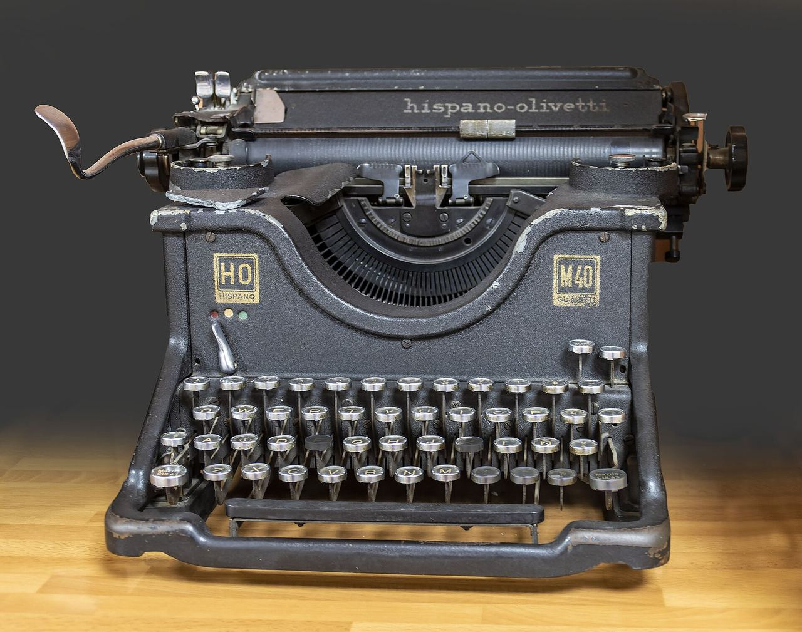

# Design System: Mecanografía · La hoja de la máquina

Dirección de arte de la práctica de Mecanografía (IPO 2026/27, grupo Dinamarca). Este documento manda sobre el
estilo por defecto; por encima de él solo está el enunciado del profesor (`Mecanografía/README.md`). Todo lo que
aquí se pide es implementable con HTML, CSS y JS nativos, sin librerías, sin CDN y sin fuentes descargadas.

---

## 1. Concepto

### 1.1 La idea

> En esta página, **la hoja de papel metida en una Hispano Olivetti** se convierte en **la prueba**: la palabra
> se teclea sobre la hoja, los aciertos quedan en tinta negra y los errores en tinta roja, como con la cinta
> bicolor de las máquinas de escribir.

La palabra de muestra aparece en la hoja en gris, como el modelo impreso de un cuaderno de academia, y la tinta va
cayendo encima letra a letra. El campo de texto es el renglón donde golpean los tipos: usa la misma fuente
monoespaciada y el mismo cuerpo que la muestra, así que cada letra tecleada queda justo debajo de la letra que la
pide. La hoja sale de un rodillo (una barra de tinta redondeada, algo más ancha que ella) y lleva en el punto de
impresión un trozo de cinta de dos bandas, negra y roja: es el único detalle de identidad fuera del error.

**Lo vivo**: al detener la prueba aparece debajo un teclado español (QWERTY con Ñ, teclas redondas como las de la
M40) que colorea con la tinta roja las teclas que más se han fallado en esa prueba concreta. Son datos reales de la
prueba y cambian cada vez.

**Prueba del competidor.** Un test de mecanografía cualquiera (fondo oscuro, fuente de programador, cursor
parpadeante) no cabe en la frase. Lo que la hace nuestra es la máquina concreta (fabricada en España, con la ñ en
el teclado), la cinta negra y roja como único color y el teclado español como lectura del resultado.

### 1.2 Inventario del tema

1. **Hispano Olivetti**: la filial española de Olivetti. La M40 de la foto lleva la marca en la barra del papel y
   el teclado tiene Ñ.
2. **La cinta bicolor negra y roja.** El rojo se reservaba para lo que debía destacar; aquí, para el error.
3. **La hoja en el rodillo**: papel claro que sale de una barra oscura. Es la figura sobre el fondo y la única
   pieza de la máquina que se dibuja en la página.
4. **El renglón**: la línea donde golpean los tipos. Es el campo.
5. **Las teclas redondas con aro metálico** de la M40, en filas escalonadas. Dan la forma del teclado de fallos
   y del favicon.
6. **El teclado español**: Ñ junto a la L y la tecla de tilde (´ y ¨) a su derecha.
7. **La letra de máquina**: cada carácter ocupa lo mismo (paso fijo). De ahí la Courier y su sucesora digital,
   Courier New.
8. **El retorno de carro**: de él viene la tecla de retorno, Intro en los teclados españoles; aquí empieza la
   prueba y valida la palabra.
9. **La academia de mecanografía**: el ejercicio con un modelo impreso que se copia debajo y el cronómetro del
   examen. Es la mecánica que pide el enunciado.
10. **El golpe del tipo**: el tipo sube, marca y vuelve. Es el único movimiento que se permite el contador.
11. **La mesa de trabajo**: el gris del esmalte y de la mesa sobre el que se apoya la hoja.

### 1.3 Atmósfera

Sobria y de oficio, como un aula de mecanografía con buena luz. Densidad media (4/10): una aplicación, no una
portada. Varianza moderada (5/10): dos columnas desiguales en escritorio y todo alineado a la izquierda. Movimiento
contenido (2/10): la teoría pide evitar "textos parpadeantes, animados", así que las letras no se mueven nunca; solo
se mueven el contador, la entrada del resultado y la pulsación del botón.

---

## 2. Auditoría de lo que hay

| Hallazgo | Por qué falla | Qué se hace |
|---|---|---|
| Tres marcadores como tarjetas iguales en fila (fondo blanco, borde 1 px, radio 0,75 rem) | Es el patrón más repetido de las plantillas; las tres cifras pesan igual aunque no importan igual | Línea de cifras sin cajas, sobre la hoja; correctas y segundos (lo que pide el enunciado) mandan y las PPM se separan al extremo |
| El escenario es otra tarjeta con borde | Borde fino como separador | La hoja se separa de la mesa por un escalón de tono, sin borde ni sombra, y sale de un rodillo de tinta |
| 92 % del texto centrado y la columna centrada en vertical | Sin ejes; el bloque se recoloca al cambiar de alto | Todo alineado a la izquierda y anclado arriba. Se resuelve el salto tras un resultado |
| Título a 3,4 vw sin protagonista | Nada domina la pantalla | Domina la palabra de la hoja (hasta 5,5 rem); el título baja a segundo nivel |
| Botón azul genérico con relleno | Azul de serie, sin relación con el tema | Botón de tinta (relleno casi negro), esquinas rectas |
| Complementaria azul/naranja + verde análogo | Tres tonos sin relación con el tema; el verde de acierto contradice la cinta | Monocromática sobre el rojo de la cinta (sección 3.1) |
| Serif Charter + sans de sistema | La serif no cuenta nada de una máquina | Monoespaciada de máquina para lo que se teclea + sans de sistema para la interfaz |
| `kbd` con borde 1 px | Caja de borde fino | Relleno con escalón de tono, sin borde |
| "Nueva mejor marca" en píldora con borde | Píldora decorativa | Frase en negrita dentro del detalle |
| Sin imágenes | Página sin mundo propio | Foto real de una Hispano Olivetti M40 (sección 6) |
| Destello verde en el contador | Color fuera de paleta | "Golpe" de 140 ms con `transform` (sección 7) |
| Sin `prefers-contrast` | No se atiende la preferencia de más contraste | Bloque `prefers-contrast: more` (sección 5.10) |

Se conserva todo lo que ya funciona bien: MVC, capas, BEM + `data-vista`, región viva única, `aria-invalid`,
atajos, gestión de teclas muertas y teclados móviles, bloqueo de pegar, `forced-colors`, foco gestionado y la
regla de que el campo no se mueve al empezar.

---

## 3. Tokens

### 3.1 Color: estrategia monocromática (tono 0°, el rojo de la cinta)

**Estrategia**: monocromática pura según el círculo de la teoría. Hay un único tono, H = 0° (el rojo del círculo
cromático de la teoría). Lo único que varía es la saturación ("del tono al gris") y la luminosidad ("de la claridad
a la oscuridad"), las dos palancas del modelo HSL que explica la teoría:

- Con S entre 5 y 14 % salen los neutros: mesa, papel, renglón, tinta y lápiz. Son grises con una temperatura
  muy leve, todos de la misma familia (no se mezclan grises fríos y cálidos).
- Con S entre 70 y 75 % sale el rojo de la cinta, reservado al error.
- La escala de calor del teclado es ese mismo tono con saturación y luminosidad escalonadas.

No hay azul, verde ni naranja. El acierto no necesita color propio: es la tinta normal, igual que en la máquina.
Todo se parametriza en `:root` con `var()` y `calc()`, como recomienda la teoría, y los dos modos se resuelven con
`light-dark()` en la misma declaración. El modo oscuro invierte la hoja ("papel carbón"): mesa casi negra, hoja un
escalón más clara y tinta clara. Se conserva la relación figura-fondo, con la hoja más clara que la mesa.

| Token | Papel | Claro (HSL · hex) | Oscuro (HSL · hex) |
|---|---|---|---|
| `--mesa` | Fondo de página | `0 7% 90%` · `#e7e4e4` | `0 7% 9%` · `#191515` |
| `--papel` | Hoja (superficie de la prueba) | `0 14% 99%` · `#fdfcfc` | `0 7% 14%` · `#262121` |
| `--renglon` | Fondo del campo | `0 10% 95%` · `#f4f1f1` | `0 7% 18%` · `#312b2b` |
| `--tinta` | Texto, letras acertadas, botón, foco | `0 12% 11%` · `#1f1919` | `0 12% 92%` · `#ede8e8` |
| `--tinta-intensa` | Hover del botón | `0 10% 24%` · `#433737` | `0 10% 80%` · `#d1c7c7` |
| `--tinta-suave` | Etiquetas, notas, crédito | `0 6% 33%` · `#594f4f` | `0 6% 72%` · `#bcb3b3` |
| `--guia` | Letras pendientes (el modelo impreso) | `0 5% 43%` · `#736868` | `0 5% 62%` · `#a39999` |
| `--borde` | Línea del renglón, controles deshabilitados | `0 6% 46%` · `#7c6e6e` | `0 6% 52%` · `#8c7d7d` |
| `--cinta` | Error: letras, mensaje, renglón inválido | `0 72% 40%` · `#af1d1d` | `0 75% 68%` · `#eb7070` |
| `--tinte-cinta` | Fondo del campo con error | `0 70% 95%` · `#fbe9e9` | `0 40% 17%` · `#3d1a1a` |
| `--calor-0` | Tecla sin fallos | `0 8% 97%` · `#f8f7f7` | `0 6% 19%` · `#332e2e` |
| `--calor-1` | Tecla, nivel 1 | `0 70% 92%` · `#f9dcdc` | `0 40% 24%` · `#562525` |
| `--calor-2` | Tecla, nivel 2 | `0 70% 83%` · `#f2b5b5` | `0 48% 31%` · `#752929` |
| `--calor-3` | Tecla, nivel 3 | `0 68% 66%` · `#e36d6d` | `0 55% 42%` · `#a63030` |
| `--calor-4` | Tecla, nivel 4 (la más fallada) | = `--cinta` | = `--cinta` |

Saturación máxima 75 % (por debajo del 80 %). No hay negro puro: la tinta más oscura es `#1f1919`.

**Contrastes medidos** (WCAG 2.x, calculados sobre estos valores):

| Par | Claro | Oscuro | Exigencia |
|---|---|---|---|
| tinta / papel | 16,96 | 13,08 | 4,5 |
| tinta / mesa | 13,71 | 14,92 | 4,5 |
| tinta / renglón | 15,44 | 11,50 | 4,5 |
| tinta-suave / mesa | 6,23 | 8,84 | 4,5 |
| guía / papel (letras pendientes) | 5,24 | 5,73 | 4,5 (es texto grande; bastaría 3) |
| cinta / papel (letra errónea, mensaje) | 6,79 | 5,34 | 4,5 |
| cinta / tinte-cinta (texto en campo con error) | 5,95 | 5,21 | 4,5 |
| cinta / mesa | 5,49 | 6,10 | 4,5 |
| papel / tinta (texto del botón) | 16,96 | 13,08 | 4,5 |
| papel / tinta-intensa (botón en hover) | 11,12 | 9,58 | 4,5 |
| borde / renglón (línea del campo) | 4,31 | 3,56 | 3 (no textual) |
| tinta-suave / calor-0 | 7,37 | 6,56 | 4,5 |
| tinta / calor-1, 2, 3 | 13,50 · 9,99 · 5,54 | 10,31 · 8,22 · 5,61 | 4,5 |
| papel / calor-4 (claro) · mesa / calor-4 (oscuro) | 6,79 | 6,10 | 4,5 |
| mesa / papel (escalón de superficie) | 1,24 | 1,14 | solo separación |

Con `prefers-contrast: more` el nivel 3 pasa a `0 68% 74%` en claro y `0 62% 36%` en oscuro (contraste con su
letra de 7,32 y 6,83, antes 5,54 y 5,61) y las teclas sin fallos llevan la letra en `--tinta` (sección 5.10).

Ojo: el rojo y el gris de las letras pendientes tienen casi la misma luminosidad (1,3 : 1). Para alguien con
protanopia pueden confundirse, por eso el error **nunca** se marca solo con color (sección 10).

### 3.2 Tipografía: dos familias contrastadas, cada una con su papel

**Estrategia**: dos fuentes contrastadas (principios de contraste y jerarquía de la teoría), las dos estándar del
sistema y sin descargas. Cada familia tiene una función fija, no un adorno:

- **La hoja: monoespaciada de máquina.** Para todo lo que "escribe la máquina": la palabra de muestra, el texto del
  campo y la cifra de PPM del resultado. La razón es funcional: con paso fijo, la letra *n* del campo cae debajo de
  la letra *n* de la muestra, porque las dos usan la misma pila, el mismo peso y el mismo cuerpo. Se usa en negrita
  (700) porque la Courier New regular es demasiado fina en pantalla; en Courier la negrita no cambia el ancho de
  los caracteres, así que no descuadra.
- **La interfaz: sans de sistema.** Para el título, las etiquetas, los marcadores, la ayuda, el botón, el detalle
  y el teclado de fallos. Es lo que "dice la aplicación".

La monoespaciada no aparece fuera de la hoja: ni en etiquetas, ni en metadatos, ni en el pie.

```css
--fuente-hoja: "Courier New", Courier, "Courier 10 Pitch", "Nimbus Mono PS", "Liberation Mono", ui-monospace, monospace;
--fuente-interfaz: system-ui, -apple-system, "Segoe UI", Roboto, "Noto Sans", "Helvetica Neue", Arial, sans-serif;
```

Windows y macOS traen Courier New. En Linux, "Courier 10 Pitch" o "Nimbus Mono PS" (clon de Courier de URW).
En Android cae en la monoespaciada del sistema. Da igual cuál se cargue: la alineación letra a letra depende de que
muestra y campo compartan pila, no de una fuente concreta.

**Escala**: la modular de razón 1,25 en `rem` que ya existe, más un cuerpo de hoja fluido. Solo se usan cinco
tamaños visibles en toda la página:

| Rol | Token | Valor | Familia · peso |
|---|---|---|---|
| Hoja (palabra, campo, cifra PPM) | `--cuerpo` | `clamp(2rem, calc((100cqi - 2 * var(--sangria)) * 1.55 / var(--letras, 8)), var(--cuerpo-max))`, con `--cuerpo-max: 5.5rem` (4.5rem si la columna mide menos de 30rem; 3.25rem en modo compacto) | hoja · 700 |
| Título `h1` | `--paso-5` | `clamp(var(--paso-3), 1.2rem + 3vw, var(--paso-5))` → de 1,95 a 3,05 rem | interfaz · 700, tracking −0,03 em, interlineado 1 |
| Cifras (marcadores y detalle) | `--paso-3` | 1,953 rem | interfaz · 700, `tabular-nums` |
| Texto (lema, etiquetas, ayuda, botón, leyenda del teclado) | `--paso-0` | 1 rem | interfaz · 400 / 600 |
| Notas (crédito, pie, letras del teclado en móvil, cuentas en las teclas) | `--paso--1` | 0,8 rem | interfaz · 400 / 600 |

El cálculo descuenta las dos sangrías y, con el avance de 0,6 em de la Courier, la palabra ocupa el 93 % del ancho
útil de la muestra hasta el tope. La más larga del almacén ("tipografía", 10 letras) sale a unos 33 px a 320 px de
ventana, 44 px a 390 y llega al tope en escritorio. El mínimo de 2rem cabe a 320 px, así que la palabra nunca se
parte (sección 5.4).

Fuera de esta escala solo queda el `kbd` (0,9 em). No se fija un número de tamaños; manda la escala.

Reglas: interlineado 1,5 en el texto corrido y 1 en la hoja y las cifras. Lema con `max-inline-size: 34ch` y
`text-wrap: pretty`. Mayúsculas solo en las teclas del teclado de fallos (convención de los teclados reales) y en
siglas. Sin etiquetas pequeñas en mayúsculas espaciadas.

### 3.3 Espacio: rejilla de dos columnas desiguales y Gestalt

**Unidades**: `rem` para tipografía y espaciado interior, `ch` para medidas de texto, `cqi` para el cuerpo de la
hoja (relativo a la propia hoja, que es contenedor de consulta), `dvh` para el alto mínimo de la página y `fr` para
las columnas. Propiedades lógicas siempre (`inline-size`, `margin-block`…). Flexbox o grid en los nodos
intermedios y flujo normal solo en las hojas del árbol, como pide la teoría.

```css
--espacio-1: 0.25rem;
--espacio-2: 0.5rem;
--espacio-3: 1rem;
--espacio-4: 1.5rem;
--espacio-5: clamp(1.5rem, 1rem + 2.5vw, 3rem);
--espacio-6: clamp(2rem, 1rem + 5vw, 6rem);   /* entre las dos columnas */
--sangria: 0.75rem;                           /* margen interior común a muestra y campo */
--ancho-maximo: 80rem;                        /* escritorio */
--ancho-columna: 44rem;                       /* una columna */
--medida: 60ch;
```

**Contenedores**:

- `.app`: rejilla de página. En escritorio (≥ 60rem) tiene dos columnas, `minmax(0, 5fr) minmax(0, 7fr)`: a la
  izquierda la cabecera y la lámina con la foto, a la derecha la prueba. Por debajo, una sola columna de 44rem como
  máximo.
- `.principal`: contenedor de consulta (`container: principal / inline-size`), como ahora.
- `.hoja`: contenedor de consulta propio (`container: hoja / inline-size`); de su ancho sale el cuerpo de la
  palabra y del campo.

**Gestalt**:

- **Figura y fondo**: la hoja (más clara en modo claro y un escalón por encima en el oscuro) es la figura y la mesa
  es el fondo. Basta un escalón de tono, sin bordes ni sombras; el rodillo de su borde superior refuerza la lectura
  del papel saliendo de la máquina.
- **Proximidad**: muestra, etiqueta, campo y mensaje de error van dentro de la hoja, juntos. El botón y la ayuda
  forman otro grupo justo debajo. El detalle del resultado queda más separado.
- **Semejanza**: todas las medidas (correctas, segundos, tiempo, precisión, mejor marca) tienen la misma forma:
  cifra grande en negrita y nombre detrás en texto normal. Lo que se parece es lo mismo. La tinta roja siempre
  significa error, en la letra, en el campo, en el mensaje y en el teclado de fallos.
- **Continuidad**: muestra y campo comparten borde izquierdo y paso de letra, así que el ojo baja en vertical de la
  letra pedida a la tecleada.
- **Cierre**: el teclado de fallos se lee como un teclado completo aunque solo sean círculos sueltos en tres filas
  escalonadas.

### 3.4 Formas, foco y tiempos

```css
--radio: 0.125rem;          /* botón, kbd: esquinas rectas, decidido una vez */
                            /* la hoja y el campo: 0. Las teclas: 50 % (la forma real de las de la M40).
                               El rodillo: extremos redondos (radio igual a su alto, 1rem) */
--anillo: 3px;              /* foco: outline de 3 px en --tinta (o --cinta si hay error), desplazado 2 px */
--hundimiento: 1px;         /* botón pulsado */
--control: 3rem;            /* alto mínimo de botón: 48 px */
--duracion: 150ms;          /* cambios de estado de color en campo y botón */
--entrada: 240ms;           /* entrada del resultado y del detalle */
--escalon: 60ms;            /* retardo entre piezas del detalle */
--golpe: 140ms;             /* golpe del contador */
--curva: cubic-bezier(0.2, 0.8, 0.2, 1);
```

### 3.5 Bloque listo para `css/tokens.css`

```css
@layer tokens, base, layout, componentes, utilidades;

@layer tokens {
  :root {
    color-scheme: light dark;

    /* Monocromática: un único tono, el rojo de la cinta. Mesa, papel y tinta son ese tono casi sin
       saturación; el error es el mismo tono saturado. */
    --tono: 0;

    --mesa: light-dark(hsl(var(--tono) 7% 90%), hsl(var(--tono) 7% 9%));
    --papel: light-dark(hsl(var(--tono) 14% 99%), hsl(var(--tono) 7% 14%));
    --renglon: light-dark(hsl(var(--tono) 10% 95%), hsl(var(--tono) 7% 18%));
    --tinta: light-dark(hsl(var(--tono) 12% 11%), hsl(var(--tono) 12% 92%));
    --tinta-intensa: light-dark(hsl(var(--tono) 10% 24%), hsl(var(--tono) 10% 80%));
    --tinta-suave: light-dark(hsl(var(--tono) 6% 33%), hsl(var(--tono) 6% 72%));
    --guia: light-dark(hsl(var(--tono) 5% 43%), hsl(var(--tono) 5% 62%));
    --borde: light-dark(hsl(var(--tono) 6% 46%), hsl(var(--tono) 6% 52%));
    --cinta: light-dark(hsl(var(--tono) 72% 40%), hsl(var(--tono) 75% 68%));
    --tinte-cinta: light-dark(hsl(var(--tono) 70% 95%), hsl(var(--tono) 40% 17%));

    /* Escala de calor del teclado de fallos: el mismo tono, cada vez más saturado */
    --calor-0: light-dark(hsl(var(--tono) 8% 97%), hsl(var(--tono) 6% 19%));
    --calor-1: light-dark(hsl(var(--tono) 70% 92%), hsl(var(--tono) 40% 24%));
    --calor-2: light-dark(hsl(var(--tono) 70% 83%), hsl(var(--tono) 48% 31%));
    --calor-3: light-dark(hsl(var(--tono) 68% 66%), hsl(var(--tono) 55% 42%));
    --calor-4: var(--cinta);
    --sobre-calor-4: light-dark(hsl(var(--tono) 14% 99%), hsl(var(--tono) 7% 9%));

    --fuente-hoja: "Courier New", Courier, "Courier 10 Pitch", "Nimbus Mono PS", "Liberation Mono", ui-monospace, monospace;
    --fuente-interfaz: system-ui, -apple-system, "Segoe UI", Roboto, "Noto Sans", "Helvetica Neue", Arial, sans-serif;

    --razon: 1.25;
    --paso--1: calc(1rem / var(--razon));
    --paso-0: 1rem;
    --paso-1: calc(var(--paso-0) * var(--razon));
    --paso-2: calc(var(--paso-1) * var(--razon));
    --paso-3: calc(var(--paso-2) * var(--razon));
    --paso-4: calc(var(--paso-3) * var(--razon));
    --paso-5: calc(var(--paso-4) * var(--razon));

    --peso-normal: 400;
    --peso-medio: 600;
    --peso-fuerte: 700;
    --interlineado: 1.5;

    --espacio-1: 0.25rem;
    --espacio-2: 0.5rem;
    --espacio-3: 1rem;
    --espacio-4: 1.5rem;
    --espacio-5: clamp(1.5rem, 1rem + 2.5vw, 3rem);
    --espacio-6: clamp(2rem, 1rem + 5vw, 6rem);
    --sangria: 0.75rem;
    --ancho-maximo: 80rem;
    --ancho-columna: 44rem;
    --medida: 60ch;

    --radio: 0.125rem;
    --anillo: 3px;
    --hundimiento: 1px;
    --control: 3rem;
    --duracion: 150ms;
    --entrada: 240ms;
    --escalon: 60ms;
    --golpe: 140ms;
    --curva: cubic-bezier(0.2, 0.8, 0.2, 1);
  }
}
```

`--paso-6`, `--fuente-display`, `--interlineado-ajustado`, `--accion*`, `--exito`, `--error`, `--tinte-error`,
`--superficie`, `--borde-suave`, `--texto*` y `--tono-complementario`/`--tono-exito` desaparecen. Hay que
renombrar sus usos en `base.css` y `componentes.css` (sección 8).

`<meta name="theme-color">`: `#e7e4e4` en claro y `#191515` en oscuro (los valores de `--mesa`).

---

## 4. Composición por estado

Reglas comunes: todo alineado a la izquierda (no se centra nada), página anclada arriba (`align-content: start`,
sin márgenes automáticos que la centren en vertical) y un único protagonista en cada estado: lo que hay en la hoja.

### 4.1 Escritorio, 1440 × 900

```
 ┌───────────────────────────────────── 1440 ──────────────────────────────────────┐
 │  padding 64                                                                     │
 │  Mecanografía                       12 correctas   34 segundos          21 ppm  │
 │  Teclea la palabra que aparece      ┌──────────────── hoja ───────────────────┐ │
 │  en la hoja. Si la completas sin    │                                         │ │
 │  fallos, suma una y sale otra.      │  relámpago        ← 88 px, guía/tinta   │ │
 │                                     │  Escribe la palabra                     │ │
 │  ┌──────── foto M40 ────────┐       │  relá▁▁▁▁▁▁▁▁▁▁▁▁▁▁▁▁▁▁▁▁▁▁▁▁▁▁▁▁▁▁▁▁  │ │
 │  │ escala de grises,        │       │  (línea del error reservada)            │ │
 │  │ proporción original      │       └─────────────────────────────────────────┘ │
 │  │ 1280:1009                │       [■ Detener]  La palabra se acepta al        │
 │  └──────────────────────────┘                    completarla. Esc detiene…      │
 │  Hispano Olivetti M40… (crédito)                                                │
 │                                                                                 │
 │  Grupo Dinamarca · IPO 2026/27                                                  │
 └─────────────────────────────────────────────────────────────────────────────────┘
   columna 5fr (~505 px)              hueco --espacio-6    columna 7fr (~700 px)
```

- Encima de la hoja va el rodillo (1rem de alto, 0,5rem más ancho por cada lado) y, justo debajo, la cinta
  bicolor alineada con la sangría de la muestra.
- La cabecera (izquierda) y los marcadores (derecha) arrancan a la misma altura.
- La foto queda a la izquierda, a la altura de la hoja: la máquina y su papel, uno junto al otro.
- La hoja es la superficie más clara de la página y la palabra, lo más grande. La foto es la masa más oscura y
  equilibra la composición sin competir por la lectura.

### 4.2 Móvil, 390 × 844

```
 ┌──────── 390 ────────┐
 │ pad 16              │
 │ Mecanografía (36px) │
 │ Teclea la palabra…  │
 │                     │
 │ 0 correctas         │  (sola en su línea: flex-basis 100 %)
 │ 0 segundos   — ppm  │  (las PPM al final de la línea)
 │ ━━━━ rodillo ━━━━━━ │
 │ ┌──── hoja ───────┐ │
 │ │ ¿Empezamos?     │ │
 │ │ Escribe la pal. │ │
 │ │ ▁▁▁▁▁▁▁▁▁▁▁▁▁▁▁ │ │
 │ └─────────────────┘ │
 │ [▶ Iniciar ──────]  │  ancho completo
 │ Pulsa Intro o …     │
 │ ── (pliegue) ────── │
 │ foto 16:9           │
 │ crédito             │
 │ pie                 │
 └─────────────────────┘
```

La lámina va **después** de la prueba en el DOM. En móvil queda debajo y la prueba ocupa la primera pantalla; en
escritorio la rejilla la sube a la columna izquierda. No hay que reordenar con `order`, así que el orden de lectura
coincide con el visual.

### 4.3 Estados

| Estado (`data-estado`) | Hoja | Marcadores | Botón y ayuda | Detalle |
|---|---|---|---|---|
| `error` (HTML de partida, sin JS o con `file://`) | Solo el aviso: texto en tinta con una franja roja de 0,25 rem a la izquierda | Visibles a 0 | Ocultos (`display: none`) | Oculto |
| `cargando` | "Cargando palabras…" en `--guia`, `--paso-4`, peso 400 | 0 · 0 · — | Botón deshabilitado (contorno discontinuo) | Oculto |
| `parado` inicial | "¿Empezamos?" igual que cargando; etiqueta y campo deshabilitado (renglón discontinuo) | 0 · 0 · — | "Iniciar" con relleno de tinta; ayuda de Intro | Oculto |
| `activo` | La palabra en `--cuerpo`: pendientes en guía, aciertos en tinta, cursor subrayado en tinta | En vivo | "Detener" en contorno de tinta; ayuda de Esc | Oculto |
| `activo` con error | Letras erróneas en cinta con subrayado ondulado; sobrantes tachadas; campo con fondo `--tinte-cinta`, renglón y foco en cinta; mensaje visible | En vivo | Igual | Oculto |
| `parado` con resultado | La muestra se oculta y en su celda aparece la cifra de PPM (`--cuerpo-max`, fuente de hoja) con "palabras por minuto" detrás; la etiqueta y el renglón vacío se ocultan con `visibility` | Valores finales; las PPM con `visibility: hidden` (la cifra está en la hoja) | "Iniciar" enfocado | Visible: datos + teclado de fallos |
| Modo compacto (`height < 34rem` y `activo`) | `--cuerpo-max: 3.25rem` | Visibles | Ayuda oculta | — |

En modo compacto se ocultan además la cabecera, la lámina y el pie, como ahora.

**Sin saltos.** La muestra, la cifra del resultado y el aviso comparten una misma celda de la rejilla de la hoja
(`grid-area: linea`). La muestra y el resultado tienen alto fijo, `block-size: calc(var(--cuerpo-max) * 1.15)`; el
aviso, que solo existe en el estado de error y puede ocupar varias líneas, se queda con `min-block-size`. La palabra
va en una sola línea (`white-space: nowrap`) y lo que se teclea de más se recorta con `overflow-x: clip` en lugar de
bajar a otra línea. El campo admite como mucho la palabra más tres letras (`maxlength`, sección 5.4) y tiene un alto
fijo (`block-size: calc(var(--cuerpo-max) * 1.3)`), aunque su letra cambie con cada palabra. El detalle va **debajo**
del botón. Por eso, al pulsar Iniciar desde el estado inicial **o desde un resultado**, al fallar, al cambiar de
palabra o al teclear de más, ni el campo ni el botón se mueven. Medido a 320, 360, 390, 768 y 1440 px: una sola
posición del campo en 25 medidas por ancho. Las PPM del marcador se esconden con `visibility` y no con `display`, para
que la línea no cambie de alto.

---

## 5. Componentes

### 5.1 Estructura HTML propuesta (`index.html`)

```html
<div class="app" data-estado="error" data-vista="app">
  <header class="cabecera">
    <h1 class="cabecera__titulo">Mecanografía</h1>
    <p class="cabecera__lema">Teclea la palabra que aparece en la hoja. Si la completas sin fallos, suma una y sale otra.</p>
  </header>

  <main class="principal">
    <h2 class="visualmente-oculto">Marcadores</h2>
    <dl class="marcadores">
      <div class="marcador">
        <dt class="marcador__etiqueta">correctas</dt>
        <dd class="marcador__valor" data-vista="correctas">0</dd>
      </div>
      <div class="marcador">
        <dt class="marcador__etiqueta">segundos</dt>
        <dd class="marcador__valor" data-vista="segundos">0</dd>
      </div>
      <div class="marcador marcador--ritmo">
        <dt class="marcador__etiqueta"><abbr title="palabras por minuto">ppm</abbr></dt>
        <dd class="marcador__valor" data-vista="ppm">—</dd>
      </div>
    </dl>

    <section class="prueba" aria-labelledby="prueba-titulo">
      <h2 class="visualmente-oculto" id="prueba-titulo">Prueba</h2>

      <div class="hoja" data-vista="hoja">
        <p class="muestra" data-vista="palabra">Cargando palabras…</p>

        <section class="resultado" data-vista="resultado" aria-labelledby="resultado-titulo" hidden>
          <h3 class="visualmente-oculto" id="resultado-titulo">Resultado</h3>
          <p class="resultado__principal">
            <span class="resultado__ppm" data-vista="resultado-ppm">0</span>
            <span class="resultado__unidad">palabras por minuto</span>
          </p>
        </section>

        <p class="aviso" data-vista="mensaje" role="alert">(texto actual del aviso)</p>

        <div class="controles">
          <label class="controles__etiqueta" for="campo">Escribe la palabra</label>
          <input class="campo" id="campo" … (atributos actuales sin cambios) disabled>
          <p class="controles__error" id="error">Palabra incompleta o con errores.</p>
        </div>
      </div>

      <div class="mando">
        <button class="boton" type="button" data-vista="boton" aria-keyshortcuts="Enter" disabled>Iniciar</button>
        <p class="ayuda ayuda--parado">Pulsa <kbd>Intro</kbd> o el botón Iniciar para empezar.</p>
        <p class="ayuda ayuda--activo" id="ayuda-activa">La palabra se acepta al completarla. <kbd>Esc</kbd> detiene la prueba.</p>
      </div>

      <section class="informe" data-vista="informe" aria-labelledby="informe-titulo" hidden>
        <h3 class="informe__titulo" id="informe-titulo">Detalle de la prueba</h3>
        <dl class="informe__datos">
          <div class="marcador"><dt class="marcador__etiqueta">tiempo</dt><dd class="marcador__valor" data-vista="resultado-tiempo">0 s</dd></div>
          <div class="marcador"><dt class="marcador__etiqueta">precisión</dt><dd class="marcador__valor" data-vista="resultado-precision">—</dd></div>
          <div class="marcador"><dt class="marcador__etiqueta">mejor marca</dt><dd class="marcador__valor" data-vista="resultado-marca">—</dd></div>
        </dl>
        <p class="informe__record" data-vista="resultado-record" hidden>Nueva mejor marca.</p>

        <figure class="fallos">
          <figcaption class="fallos__resumen" data-vista="fallos-resumen"></figcaption>
          <div class="teclado" data-vista="teclado" aria-hidden="true"></div>
        </figure>
      </section>
    </section>

    <p class="visualmente-oculto" data-vista="anuncio" aria-live="polite"></p>
  </main>

  <aside class="lamina" aria-label="La máquina">
    <figure class="lamina__figura">
      
      <figcaption class="lamina__credito">(sección 6)</figcaption>
    </figure>
  </aside>

  <footer class="pie"><p>Grupo Dinamarca · IPO 2026/27</p></footer>
</div>
```

Cambios respecto al HTML actual: `escenario` pasa a llamarse `hoja`, con `data-vista="hoja"`; los controles entran
en la hoja; el botón sale a `.mando` junto a la ayuda; el detalle pasa a la sección nueva `.informe`, debajo del
botón; se retira `resultado-correctas` (las correctas finales ya están en el marcador); se añade la lámina. El
comentario del HTML sobre el estado de error se conserva.

### 5.2 Cabecera

- `h1`: fuente de interfaz, 700, `clamp(var(--paso-3), 1.2rem + 3vw, var(--paso-5))`, `letter-spacing: -0.03em`,
  `line-height: 1`, color `--tinta`. Cabe en una línea en todos los anchos (unos 400 px a 60 px de cuerpo).
- Lema: `--paso-0`, color `--tinta` (es texto corrido, no nota), `max-inline-size: 34ch`, `text-wrap: pretty`.
- Ninguna etiqueta encima del título.

### 5.3 Marcadores

- `.marcadores`: `display: flex; flex-wrap: wrap; align-items: baseline; gap: var(--espacio-2) var(--espacio-5)`.
- `.marcador`: `display: flex; align-items: baseline; gap: 0.35em`. El `dd` va primero en pantalla con
  `order: -1`: se lee "12 correctas", y el lector de pantalla oye "correctas, 12" (orden del DOM, `dt` antes de
  `dd`).
- `.marcador__valor`: interfaz 700, `--paso-3`, `line-height: 1`, `tabular-nums`, sin ancho mínimo: así el borde
  izquierdo de las cifras coincide con el de la hoja. La etiqueta se desplaza un dígito al pasar de 9 a 10, una sola
  vez por prueba.
- `.marcador__etiqueta`: `--paso-0`, `--tinta-suave`. `abbr` sin subrayado.
- `.marcador--ritmo`: `margin-inline-start: auto`. Las PPM son un dato derivado: se van al extremo y pesan menos
  por posición.
- Si `.principal` mide menos de 30rem, el primer marcador toma `flex-basis: 100%`: las correctas quedan solas en una
  línea y los segundos y las PPM comparten la siguiente, en los dos extremos. Así las PPM nunca quedan sueltas.
- Sin fondo, sin borde, sin radio. Los datos del detalle reutilizan exactamente este componente (semejanza).
- Golpe al acertar: clase `marcador__valor--golpe` (sección 7).
- En el resultado: `.app:has(.resultado:not([hidden])) .marcador--ritmo { visibility: hidden; }`.

### 5.4 Hoja: muestra, campo y error

```
.hoja           grid; columns minmax(0, 1fr); areas "linea" / "controles";
                gap: calc(var(--cuerpo-max) * 0.2)  (deja sitio al subrayado ondulado del error);
                padding: var(--espacio-5) var(--espacio-4) var(--espacio-4);
                margin-block-start: calc(var(--rodillo) / 2); position: relative;
                background: var(--papel); sin borde visible, sin sombra, sin radio;
                border: 1px solid transparent  (solo se ve en forced-colors);
                container: hoja / inline-size;
                --rodillo: 1rem; --cuerpo-max: 5.5rem;
                --cuerpo: clamp(2rem, calc((100cqi - 2 * var(--sangria)) * 1.55 / var(--letras, 8)), var(--cuerpo-max));
.hoja::before   rodillo: absolute; inset-block-start: calc(var(--rodillo) / -2);
                inset-inline: calc(var(--espacio-2) * -1); block-size: var(--rodillo);
                background: var(--tinta); border-radius: var(--rodillo)
.hoja::after    cinta: absolute; inset-block-start: calc(var(--rodillo) * 0.75);
                inset-inline-start: calc(var(--espacio-4) + var(--sangria)); 2.5rem × 0.5rem;
                background: var(--cinta); border-block-start: 0.25rem solid var(--tinta)  (dos bandas planas)
.muestra, .resultado, .aviso    grid-area: linea; align-content: end (la línea se apoya abajo, cerca del renglón)
.muestra, .resultado            block-size: calc(var(--cuerpo-max) * 1.15)   (alto fijo)
.aviso                          min-block-size: calc(var(--cuerpo-max) * 1.15)
```

- `--letras` lo escribe la vista en `.hoja` (antes en `.muestra`), así muestra y campo heredan el mismo cuerpo.
  `cqi` se resuelve en los hijos, cuyo contenedor más cercano es la hoja.
- El rodillo y la cinta son los dos únicos adornos de la página; los dos son planos, sin gradiente ni sombra. En
  modo oscuro el rodillo toma la tinta clara (la misma inversión de papel carbón que el resto).
- `.muestra` (activo): `font: 700 var(--cuerpo)/1 var(--fuente-hoja); letter-spacing: 0;
  padding-inline: var(--sangria); white-space: nowrap; overflow-x: clip;` color por letra:
  - `.letra--pendiente`: `--guia`.
  - `.letra--ok`: `--tinta`.
  - `.letra--error`: `--cinta` + `text-decoration: underline wavy; text-decoration-thickness: 0.06em;
    text-underline-offset: 0.18em; text-decoration-skip-ink: none`.
  - `.letra--sobrante`: igual pero `line-through`.
  - `.letra--cursor`: `underline solid var(--tinta)`, grosor 0,08 em, separación 0,14 em. No parpadea.
- `.muestra` (no activo): `font-size: min(var(--paso-4), calc((100cqi - 2 * var(--sangria)) * 1.55 / 11))`, para
  que "¿Empezamos?" (11 caracteres) quepa a 320 px; peso 400, color `--guia`, `white-space: normal` para que
  "Cargando palabras…" pueda partirse. En `error`: `display: none`.
- `.controles__etiqueta`: interfaz `--paso-0`, `--tinta-suave`, `padding-inline: var(--sangria)`.
- `.campo`: `font: 700 var(--cuerpo)/1 var(--fuente-hoja); letter-spacing: 0; padding: 0 var(--sangria);
  inline-size: 100%; block-size: calc(var(--cuerpo-max) * 1.3); color: var(--tinta);
  background: var(--renglon); border: 0; border-block-end: 2px solid var(--borde); border-radius: 0;
  caret-color: var(--tinta); text-align: start`.
  - `:focus-visible`: `outline: var(--anillo) solid var(--tinta); outline-offset: 2px`.
  - `[aria-invalid="true"]`: `background: var(--tinte-cinta); border-block-end-color: var(--cinta);
    caret-color: var(--cinta)`, y con foco el outline pasa a `--cinta`. Se ve un solo anillo, rojo.
  - `:disabled`: `background: transparent; border-block-end-style: dashed; cursor: not-allowed`.
  - Invariante: muestra y campo tienen la misma pila, peso, cuerpo, `letter-spacing` y sangría. Si alguna cambia,
    se pierde la alineación letra a letra.
- Límite de longitud: al mostrar cada palabra, la vista escribe `maxlength` = letras de la palabra + 3
  (`SOBRANTES_MAX`). Más allá no aporta nada y rompería la línea.
- Con el resultado abierto, `.hoja:has(.resultado:not([hidden])) :is(.controles__etiqueta, .campo)` lleva
  `visibility: hidden`: no queda una etiqueta huérfana sobre un renglón vacío y el alto no cambia.
- `.controles__error`: interfaz `--paso-0`, 600, `--cinta`, `padding-inline: var(--sangria)`, alineado a la
  izquierda, `visibility: hidden` (línea reservada) y visible con `.campo[aria-invalid="true"] + .controles__error`
  (son hermanos; no hace falta `:has()`).
- `.aviso`: interfaz `--paso-0`, `--tinta`, `max-inline-size: var(--medida)`,
  `padding-inline-start: var(--espacio-3); border-inline-start: 0.25rem solid var(--cinta)`.

### 5.5 Botón y ayuda (`.mando`)

- `.mando`: grid `grid-template-columns: auto 1fr; grid-template-areas: "boton ayuda"; align-items: center;
  gap: var(--espacio-3)`. Las dos ayudas comparten el área `ayuda` y se alternan con `visibility` (como ahora).
  Si `.principal` mide menos de 30rem, se apilan (`"boton" "ayuda"`) y el botón ocupa el ancho completo.
- `.boton`: `min-block-size: var(--control); min-inline-size: 10ch; padding: var(--espacio-2) var(--espacio-4);
  font: 600 var(--paso-0) var(--fuente-interfaz); border: 2px solid var(--tinta); border-radius: var(--radio)`.
  Se mantiene el sistema de variables locales `--_fondo`/`--_tinta`:
  - Iniciar: `--_fondo: var(--tinta); --_tinta: var(--papel)`. Hover (solo con `(hover: hover)`):
    `--_fondo: var(--tinta-intensa)`.
  - Detener (`activo`): `--_fondo: transparent; --_tinta: var(--tinta)`. Hover: `--_fondo: var(--renglon)`.
  - `:active`: `translate: 0 var(--hundimiento)`.
  - `:disabled`: transparente, borde discontinuo `--borde`, texto `--tinta-suave`.
  - Se conserva el icono `::before` (triángulo/cuadrado con `clip-path`).
- `.ayuda`: `--paso-0`, `--tinta-suave`, alineada a la izquierda.
- `kbd`: interfaz 600, 0,9 em, `padding: 0.05em 0.45em; background: var(--renglon); color: var(--tinta);
  border-radius: var(--radio)`. Sin borde: se separa de la mesa por el escalón de tono.

### 5.6 Resultado en la hoja

- `.resultado__principal`: `display: flex; align-items: last baseline; gap: var(--espacio-2) var(--espacio-3);
  padding-inline: var(--sangria)`. La unidad puede partirse en varias líneas y su última línea se apoya en la línea
  base de la cifra.
- `.resultado__ppm`: `font: 700 var(--cuerpo-max)/1 var(--fuente-hoja); font-variant-numeric: tabular-nums;
  color: var(--tinta)`. Es la cifra que "escribe la máquina".
- `.resultado__unidad`: interfaz `--paso-0`, `--tinta-suave`; se parte si no cabe.
- A 390 px "148" a 72 px ocupa unos 130 px y la unidad cabe en una o dos líneas; a 320 px se parte en tres. Una
  cifra de cuatro dígitos (más de 1000 ppm, imposible tecleando de verdad) sacaría la unidad unos píxeles de la hoja
  a 320 px, sin provocar scroll.

### 5.7 Detalle (`.informe`)

- `margin-block-start: var(--espacio-5)`. Grid de una columna con `gap: var(--espacio-4)`.
- `.informe__titulo`: interfaz `--paso-0`, 700, `--tinta`. Es un `h3` normal, no una etiqueta.
- `.informe__datos`: misma maqueta que `.marcadores` (flex con *wrap*), con tiempo ("34,2 s"), precisión ("93 %")
  y mejor marca ("52 ppm").
- `.informe__record`: "Nueva mejor marca." en `--paso-0`, 700, `--tinta`. Sin píldora ni borde.

### 5.8 Teclado de fallos (lo vivo)

**Qué muestra.** Las tres filas de letras del teclado español, escalonadas como en la M40:

```js
const FILAS = ['qwertyuiop', 'asdfghjklñ´', 'zxcvbnm'];   // 10 + 11 + 7 = 28 teclas
```

La tecla `´` (a la derecha de la Ñ) recoge los fallos de tilde y de diéresis, que en el teclado español van en esa
misma tecla. Todas las letras del almacén (a–z, á é í ó ú ü, ñ) caben en estas 28 teclas.

**Datos del modelo (`modelo.js`).**

```js
// Vocal acentuada → su vocal base. La tilde y la diéresis se escriben con la tecla ´ (¨ con mayúsculas).
const BASE_ACENTUADA = { á: 'a', é: 'e', í: 'i', ó: 'o', ú: 'u', ü: 'u' };

#fallosPorTecla = new Map();                  // se vacía en comenzar()

/** Copia de los fallos de la prueba por tecla: Map<tecla, número>. */
get fallosPorTecla() { return new Map(this.#fallosPorTecla); }

#anotarFallo(esperada, escrita) {
  if (esperada === undefined) return;         // lo tecleado de más no corresponde a ninguna tecla
  const tecla = Modelo.#teclaDe(esperada, escrita);
  this.#fallosPorTecla.set(tecla, (this.#fallosPorTecla.get(tecla) ?? 0) + 1);
}

// Se culpa a la tecla de la letra pedida; si solo faltó la tilde (a por á), a la tecla ´.
static #teclaDe(esperada, escrita) {
  const base = BASE_ACENTUADA[esperada];
  if (base && escrita === base) return '´';
  return base ?? esperada;
}
```

- En `escribir()`, dentro del bucle, cuando `intento[i] !== this.#objetivo[i]`: `this.#fallos++` (como ahora) y
  `this.#anotarFallo(this.#objetivo[i], intento[i])`.
- En `confirmar()`, cuando la confirmación falla, solo se penaliza si lo escrito no tenía ya un error
  (`!this.hayError`): entonces suma una pulsación, un fallo y `this.#anotarFallo(this.#objetivo[this.#intento.length])`,
  que culpa a la letra que faltaba. Si ya había un error, ese fallo se contó al teclearlo y Espacio o Intro no suman
  otro. Así cada `#fallos++` va con su anotación (salvo lo tecleado de más) y la suma del teclado nunca supera los
  fallos de la precisión.
- La ñ no se descompone: es su propia tecla (cuidado, `'ñ'.normalize('NFD')` da `n` + tilde combinada; por eso se
  usa la tabla explícita y no NFD).
- La suma del teclado puede ser menor que los fallos totales de la precisión, nunca mayor: lo que se teclea de más
  no se atribuye a ninguna tecla. Se explica en el README.
- `previsualizar` (composición del móvil) no anota nada, porque `progreso()` no altera el estado.

**Controlador.** En `#detener()`, después de `clearInterval` y `this.#modelo.detener()`:

1. `this.#refrescarMarcadores()` para que correctas y segundos muestren el valor final y no el del último tic.
2. Pasar `fallos: this.#modelo.fallosPorTecla` a `vista.mostrarResultado`.

**Vista.**

- En el constructor, `#crearTeclado(nodo('teclado'))` genera una vez las filas y devuelve un
  `Map<tecla, {tecla, cuenta}>`:

  ```html
  <div class="teclado__fila">
    <span class="tecla" data-nivel="0"><span class="tecla__letra">q</span><span class="tecla__cuenta"></span></span>
    …
  </div>
  ```

- `#pintarFallos(fallos)`: `max = Math.max(0, ...fallos.values())`; para cada tecla,
  `n = fallos.get(t) ?? 0`, `nivel = n === 0 ? 0 : Math.ceil((n / max) * 4)`, escribe `data-nivel` y
  `cuenta.textContent = n || ''`. El reparto en niveles es presentación y vive en la vista; qué tecla se ha fallado
  es una regla del dominio y vive en el modelo.
- Resumen (`fallos-resumen`), con `Intl.ListFormat('es', { type: 'conjunction' })`, ordenado de más a menos
  fallos y como mucho cinco teclas (la `´` se nombra "tilde"):
  - "Teclas con fallos: ñ (3), r (2) y tilde (1)."
  - Con más de cinco: "Teclas con fallos: ñ (3), r (2), a (2), s (1), o (1) y 3 más."
  - Sin fallos: "Ninguna tecla fallada en esta prueba."
  - Sin pulsaciones (`precision === null`): "No se ha tecleado nada en esta prueba."
- El anuncio final de la región viva añade la frase completa del resumen: "… precisión del 93 %. Teclas con
  fallos: ñ (3), r (2) y tilde (1)." (con precisión `null` no añade nada).
- La vista solo reescribe la clase de una letra si su estado cambia, y bloquea pegar y arrastrar con una lista
  explícita de `inputType` (`insertFromPaste`, `insertFromDrop`, `insertFromYank`, `insertFromPasteAsQuotation`),
  sin tocar la composición de teclas muertas.

**CSS.**

```
.teclado        grid; grid-template-columns: repeat(23, minmax(0, 1fr)); gap: var(--espacio-1);
                max-inline-size: 36rem; container: teclado / inline-size;
.teclado__fila  grid-column: 1 / -1; display: grid; grid-template-columns: subgrid;
.tecla          grid-column: span 2; aspect-ratio: 1; border-radius: 50%;
                display: grid; place-content: center; justify-items: center;
                font: 600 var(--paso-0)/1 var(--fuente-interfaz); text-transform: uppercase;
                background: var(--calor-0); color: var(--tinta-suave);
.teclado__fila:nth-child(2) > :first-child { grid-column: 2 / span 2; }   /* media tecla */
.teclado__fila:nth-child(3) > :first-child { grid-column: 3 / span 2; }   /* una tecla */
@container principal (inline-size < 30rem) { .teclado { column-gap: 0.125rem; } }   /* teclas más grandes */
.tecla[data-nivel="1"] { background: var(--calor-1); color: var(--tinta); }
.tecla[data-nivel="2"] { background: var(--calor-2); color: var(--tinta); }
.tecla[data-nivel="3"] { background: var(--calor-3); color: var(--tinta); }
.tecla[data-nivel="4"] { background: var(--calor-4); color: var(--sobre-calor-4); }
.tecla__cuenta  font-size: var(--paso--1); tabular-nums;
@container teclado (inline-size < 30rem) { .tecla { font-size: var(--paso--1); } .tecla__cuenta { display: none; } }
```

Con 36rem las teclas miden unos 46 px; con el hueco de 2 px de las columnas estrechas, unos 29 px a 390 px y 23 px
a 320 px (las cuentas se ocultan y las da la leyenda). `grid-column-start` solo no basta en las primeras teclas
escalonadas: anularía el `span 2` y la tecla ocuparía una sola columna.

**Accesibilidad.** La rejilla lleva `aria-hidden="true"` y no tiene nada enfocable. Toda la información está en el
`figcaption`, que da nombre a la `figure` y es texto visible: un lector de pantalla oye "Teclas con fallos: ñ (3),
r (2) y tilde (1)" en lugar de recorrer 28 teclas. El nivel tampoco depende solo del color: en escritorio se ve la
cuenta dentro de cada tecla y en cualquier ancho está la leyenda. En `forced-colors` las teclas con fallos pasan a
`Mark`/`MarkText` (sección 5.10).

### 5.9 Lámina y pie

- `.lamina`: en escritorio, área `lamina` de la columna izquierda (`align-self: start`); en una columna, después de
  la prueba.
- `.lamina__foto`: `display: block; inline-size: 100%; block-size: auto; filter: grayscale(1);` sin radio, sin
  sombra, sin marco. En una columna: `aspect-ratio: 16 / 9; object-fit: cover; object-position: 50% 30%` (carro con
  la marca y filas de teclas). En escritorio, proporción original 1280:1009, sin recorte.
- `.lamina__credito`: `--paso--1`, `--tinta-suave`, `margin-block-start: var(--espacio-2)`, `max-inline-size: 48ch`.
  Enlaces en `--tinta`, subrayados.
- `.pie`: `--paso--1`, `--tinta-suave`, alineado a la izquierda, en el área `pie`, a todo el ancho.

### 5.10 Alto contraste y contraste aumentado

`@media (forced-colors: active)`, además de lo que ya hay (letras erróneas en `Mark`, icono del botón en
`ButtonText`/`GrayText`, campo con error en borde doble):

- La hoja tiene `border: 1px solid transparent`, que en este modo se pinta y delimita la hoja.
- Campo: borde completo de 2px (doble de 4px con error) y `padding-inline: calc(var(--sangria) - borde)`, para
  que el texto siga cayendo bajo su letra.
- Rodillo: `forced-color-adjust: none` y `CanvasText`, para que no tape el borde de la hoja. La cinta se retira
  (`display: none`): es decorativa.
- Teclas: `forced-color-adjust: none`; nivel 0 con `Canvas`/`CanvasText` y borde `CanvasText`; niveles 1–4 con
  `Mark`/`MarkText`. Las cuentas se muestran siempre.
- Foco del campo: `outline` en `Highlight` (ya existe).

`@media (prefers-contrast: more)` (nuevo):

- `--guia: var(--tinta-suave)`, `--borde: var(--tinta-suave)`.
- `--mesa` un escalón más oscuro en claro (`hsl(0 7% 85%)`) y más negro en oscuro (`hsl(0 7% 6%)`), para que la
  hoja destaque más.
- `--calor-3` más separado de su letra: `0 68% 74%` en claro y `0 62% 36%` en oscuro.
- Letra de las teclas sin fallos en `--tinta`.
- Renglón de 3 px y subrayado ondulado de error de 0,09 em (cabe gracias al hueco proporcional de la hoja).

### 5.11 Favicon

Una tecla de la M40: círculo de tinta (`#1f1919`), aro claro (`#e7e4e4`, 1,5 de trazo) y una "ñ" en papel
(`#fdfcfc`), con la fuente de la hoja en negrita. Sustituye al cuadrado azul con la "a" en Georgia.

```svg
<svg xmlns="http://www.w3.org/2000/svg" viewBox="0 0 32 32">
  <circle cx="16" cy="16" r="15" fill="#1f1919"/>
  <circle cx="16" cy="16" r="12.5" fill="none" stroke="#e7e4e4" stroke-width="1.5"/>
  <text x="16" y="21.5" fill="#fdfcfc" font-family="'Courier New', Courier, monospace" font-size="17" font-weight="700" text-anchor="middle">ñ</text>
</svg>
```

---

## 6. La imagen

- **Fichero**: `img/hispano-olivetti-m40.jpg`, 1280 × 1009 px, 192 KB (reducida desde la versión de 1920 px).
- **Obra**: "Máquina de escribir Hispano Olivetti M40". La ficha dice literalmente "fabricada en España en la década
  de 1930"; el lugar de fábrica no figura en ella.
- **Autor**: Amfeli. **Licencia**: CC BY 4.0 (https://creativecommons.org/licenses/by/4.0), sin "compartir igual".
- **Fuente**: https://commons.wikimedia.org/wiki/File:M%C3%A1quina_de_escribir_Hispano_Olivetti_M40.jpg
- **Por qué esta**: es una Hispano Olivetti de verdad (la marca se lee en la barra del papel) y su teclado tiene Ñ,
  que es justo el teclado que dibuja el componente vivo. Se descartó la Pluma 22 (vitrina de museo con carteles
  alrededor y CC BY-SA) y las fotos del edificio de Barcelona.
- **Dónde**: lámina de la columna izquierda en escritorio y, en móvil, después de la prueba.
- **Tratamiento**: escala de grises con `filter: grayscale(1)` para que el suelo de madera no meta un tono ajeno a
  la monocromía. Esquinas rectas, sin sombra ni marco. Nada se superpone a la foto.
- **Crédito en `figcaption`** (obligatorio con CC BY; hay que indicar los cambios):

  ```html
  Hispano Olivetti M40, fabricada en España en la década de 1930 según su ficha. Foto de Amfeli,
  <a href="https://commons.wikimedia.org/wiki/File:M%C3%A1quina_de_escribir_Hispano_Olivetti_M40.jpg">Wikimedia Commons</a>,
  <a href="https://creativecommons.org/licenses/by/4.0/deed.es">CC BY 4.0</a>; reducida y en escala de grises.
  ```

- La foto muestra el mundo de la práctica y no se presenta como nada propio.

---

## 7. Movimiento

Solo `transform` y `opacity`. Todo va dentro de `@media (prefers-reduced-motion: no-preference)`. Con
`reduce`, el contenido aparece igual, sin desplazamiento ni fundido.

| Qué | Cómo | Cuándo |
|---|---|---|
| Golpe del contador | `@keyframes golpe { from { transform: translateY(-0.15em); } }`, `var(--golpe)`, `var(--curva)`. Sustituye al destello verde; la vista reinicia la clase `marcador__valor--golpe` con el reflow que ya usa | Cada acierto |
| Botón | `translate: 0 1px` en `:active` (ya existe); transición de color de `var(--duracion)` | Pulsación y hover |
| Resultado en la hoja | `@starting-style { opacity: 0; transform: translateY(var(--espacio-2)); }`, `var(--entrada)` | Al detener |
| Detalle | Mismo `@starting-style` en `.informe__titulo`, `.informe__datos`, `.fallos` con `transition-delay` 0, `var(--escalon)` y `calc(var(--escalon) * 2)`; las filas del teclado, 60 ms más cada una (`:nth-child`) | Al detener |
| Campo | Transición de color de fondo y renglón, `var(--duracion)`. Es un cambio de color, no movimiento | Error y foco |

**Nunca**: animar letras, palabra o cursor (la teoría pide evitar los textos animados y parpadeantes), bucles
infinitos, parallax, cursores personalizados ni animar `width`, `height`, `top` o `left`.

---

## 8. Cambios por fichero

| Fichero | Cambio |
|---|---|
| `index.html` | Estructura de 5.1: `hoja`, controles dentro de la hoja, `.mando`, `.informe` con `figure` del teclado, `aside.lamina` con la foto y su crédito; quitar `resultado-correctas`; textos de marcadores en minúscula; lema nuevo; `theme-color` `#e7e4e4` / `#191515` |
| `css/tokens.css` | Sustituir por el bloque 3.5 |
| `css/base.css` | `body` con `--mesa`, `--tinta` y `--fuente-interfaz`; `h1` sin la serif (la familia la pone el componente); `figure { margin: 0 }`; `img { max-inline-size: 100%; block-size: auto }`; `a { color: var(--tinta); text-underline-offset: 0.15em }`; foco global en `--tinta` |
| `css/layout.css` | `.hoja` con `position: relative`, columna `minmax(0, 1fr)` y hueco proporcional; celda `linea` de alto fijo; marcadores en dos líneas por debajo de 30rem; huecos del teclado más estrechos; `.app` como rejilla con áreas (`cabecera principal / lamina principal / pie pie` desde 60rem; una columna debajo), anclada arriba; `.marcadores` en flex con *wrap*; `.hoja` con áreas `linea / controles`; `.controles` en una columna (etiqueta, campo, error); `.mando`; `.informe`; `.teclado` con *subgrid*; consultas de contenedor de 30rem para `.mando` y `--cuerpo-max`; quitar la rejilla de tres columnas y el centrado |
| `css/componentes.css` | Reescribir el aspecto de cada componente según la sección 5: sin tarjetas ni bordes de 1 px, colores nuevos, letras en tinta, guía y cinta, campo como renglón, botón de tinta, teclado de fallos, lámina, `kbd` sin borde; golpe en lugar de destello; `forced-colors` ampliado; `prefers-contrast: more` nuevo; modo compacto con `--cuerpo-max: 3.25rem` y ocultando también `.lamina`; rodillo y cinta (`.hoja::before` y `::after`); palabra sin cortes; etiqueta y renglón ocultos en el resultado |
| `js/model/modelo.js` | `BASE_ACENTUADA`, `#fallosPorTecla` (se vacía en `comenzar`), getter `fallosPorTecla`, `#anotarFallo`, `#teclaDe`; llamadas en `escribir` y `confirmar`; `confirmar` solo penaliza si no había ya un error |
| `js/view/vista.js` | Nodos `hoja`, `informe`, `teclado`, `fallos-resumen`; `--letras` en la hoja; `#crearTeclado` y `#pintarFallos`; `mostrarPrueba` oculta el detalle; `mostrarResultado` recibe `fallos`, deja de escribir las correctas, muestra el detalle y añade el resumen al anuncio; clase `marcador__valor--golpe`; `maxlength` por palabra; atajo de Intro ignorado sobre `a, button, input`; lista explícita de inserciones bloqueadas; clases de letra solo si cambian |
| `js/controller/controlador.js` | En `#detener`, refrescar los marcadores tras detener el modelo y pasar `fallosPorTecla` a la vista |
| `favicon.svg` | Tecla de la M40 (5.11) |
| `img/hispano-olivetti-m40.jpg` | Nuevo (ya descargado) |
| `README.md` | Ver sección 9 |

**No se toca**: `js/main.js`, `js/model/almacen.js`, `data/palabras.json`, la lógica del temporizador
(`setInterval`/`clearInterval`, `REFRESCO_MS`, `PPM_DESDE_MS`, tiempo con `performance.now()`), la validación
(`progreso`, `escribir`, `confirmar`, normalización NFC y minúsculas), los atajos, la gestión de `compositionend` y
del espacio en móviles, el bloqueo de pegar, la región viva única, `aria-invalid`/`aria-errormessage`,
`aria-keyshortcuts`, `interactive-widget=resizes-content`, el orden de capas, la convención BEM + `data-vista`,
`.github/` y `Mecanografía/`.

---

## 9. Qué hay que reescribir del README

- **Funcionamiento**: el resultado ya no sustituye a los marcadores. La cifra de PPM aparece en la hoja, los
  marcadores conservan correctas y segundos finales, y debajo del botón aparece el detalle con el teclado de
  fallos. Explicar cómo se atribuye un fallo a una tecla (la letra pedida; la tecla ´ si solo faltó la tilde o la
  diéresis; lo que sobra no se atribuye).
- **Estructura**: añadir `img/`, `DESIGN.md` y el favicon nuevo.
- **Coordinación con el DOM y el CSSOM**: `--letras` se escribe en `.hoja` y lo usan muestra y campo; `data-nivel`
  en las teclas; `:has()` para esconder las PPM del marcador con el resultado abierto; *subgrid* en el teclado;
  `align-content` en bloques.
- **Diseño**, entero:
  - Cromático: monocromática sobre el rojo de la cinta (H = 0°), con tabla de papeles y contrastes.
  - Tipográfico: monoespaciada de máquina para lo que se teclea y sans de sistema para la interfaz, con la razón
    funcional de la alineación letra a letra.
  - Espacial: dos columnas desiguales, página anclada arriba, sin saltos (celda compartida en la hoja, alto fijo
    del campo, detalle debajo del botón) y lista de Gestalt actualizada. Hay que borrar el párrafo de "como el
    bloque está centrado en vertical…".
- **Interacción y accesibilidad**: golpe del contador en lugar del destello; accesibilidad del teclado de fallos
  (rejilla oculta, leyenda completa, anuncio); `forced-colors` ampliado y `prefers-contrast` nuevo.
- **Créditos** (sección nueva): la foto con autor, licencia, enlace y cambios.

---

## 10. Riesgos y cómo evitarlos

| Riesgo | Prevención |
|---|---|
| Romper el temporizador | No tocar `#comenzar` ni el intervalo. En `#detener`, el orden es `clearInterval` → `modelo.detener()` → `#refrescarMarcadores()` → `mostrarResultado`. Comprobar que el reloj se para y que `segundos` final = `Math.floor(ms / 1000)` |
| El campo salta al empezar | Celda compartida con `block-size` fijo, palabra en una línea, `maxlength` y campo con `block-size` fijo. Prueba con Playwright: `campo.getBoundingClientRect().top` igual antes y después de Iniciar, desde el estado inicial y desde un resultado (0 px) |
| Se pierde la alineación letra a letra | Misma pila, peso, cuerpo, `letter-spacing: 0` y `--sangria` en muestra y campo. Prueba: el borde izquierdo del primer `span` de la muestra coincide (±1 px) con `campo.left + padding-left`, y el ancho de un `span` coincide con `measureText` de un carácter en la fuente del campo |
| Teclados móviles | Cuerpo del campo siempre ≥ 2rem (iOS no hace zoom por encima de 16 px). El alto fijo evita que cambiar de palabra mueva el campo con el teclado abierto. El modo compacto baja `--cuerpo-max` a 3.25rem. No se tocan `compositionend` ni la detección del espacio |
| Contraste del rojo | Valores medidos en 3.1. Rojo y guía tienen casi la misma luminosidad, así que el error nunca va solo con color: subrayado ondulado, tachado en lo que sobra, fondo y renglón del campo, mensaje escrito y anuncio |
| `cqi` dentro de una variable | `--cuerpo` se declara en `.hoja` pero se usa en sus hijos; `.hoja` debe tener `container-type: inline-size` o `cqi` se resolvería contra `.principal` |
| `align-content` en bloques | Necesita navegadores de 2024 en adelante. Sin soporte, la palabra queda arriba de su celda; no se rompe nada |
| Courier New ausente o muy fina | Peso 700 y pila con equivalentes de Linux; cualquier monoespaciada conserva la alineación |
| Teclado de fallos invisible para tecnologías de apoyo | La rejilla va oculta a propósito; la leyenda tiene todos los datos y se comprueba en el árbol de accesibilidad |
| El inspector de la skill marca la monoespaciada | Excepción justificada (sección 3.2): solo en `.muestra`, `.campo` y `.resultado__ppm` |
| Intro sobre un enlace del crédito arranca la prueba | El atajo de comenzar se ignora si el foco está en `a`, `button` o `input` |
| Foto pesada o que desplaza la prueba | 192 KB con `width`/`height` (sin CLS); en móvil va después de la prueba |
| Licencia | CC BY 4.0: crédito visible junto a la foto con enlace, licencia e indicación de cambios |

---

## 11. Prohibido

- Tarjetas con borde de 1 px, filas de cajas iguales, sombras en reposo, brillos, gradientes, glassmorphism.
- Etiquetas pequeñas en mayúsculas espaciadas, píldoras, numeración tipo 01/02/03, emojis.
- Texto centrado por defecto y la columna centrada en vertical.
- Cualquier tono distinto de H = 0° (nada de azul, verde ni naranja), negro puro y saturación por encima del 80 %.
- Monoespaciada fuera de la hoja, más de dos familias, fuentes descargadas, librerías o CDN.
- Animar letras, palabra o cursor; parpadeos; bucles infinitos.
- Marcar el error solo con color.
- Poner texto encima de la foto o presentarla como propia.

---

## 12. Cómo comprobar que está bien

1. Playwright a 1440, 768, 390 y 320 px, modos claro y oscuro: estados inicial, activo, activo con error y
   resultado. Sin desbordamiento horizontal a 320, 360 y 390.
2. Campo inmóvil al pulsar Iniciar desde el estado inicial y desde un resultado, en cinco palabras seguidas, al
   fallar y al teclear 20 letras (riesgos de la sección 10).
3. Alineación letra a letra medida (sección 10).
4. Teclado de fallos: equivocarse a propósito en una ñ y en una tilde (escribir "arbol" para "árbol") y comprobar
   el nivel de la Ñ y de la ´, y la leyenda.
5. `prefers-reduced-motion: reduce`, `forced-colors: active` y `prefers-contrast: more` emulados.
6. Lector de pantalla (o árbol de accesibilidad): anuncio de inicio, error, resumen con teclas; el reloj no se
   anuncia.
7. `lint.mjs` e `inspect.mjs` de la skill, ejecutados desde fuera del repositorio para no dejar `.taste-skill/`.
   Sin FAIL; el único WARN aceptable es el de la monoespaciada de la hoja.
