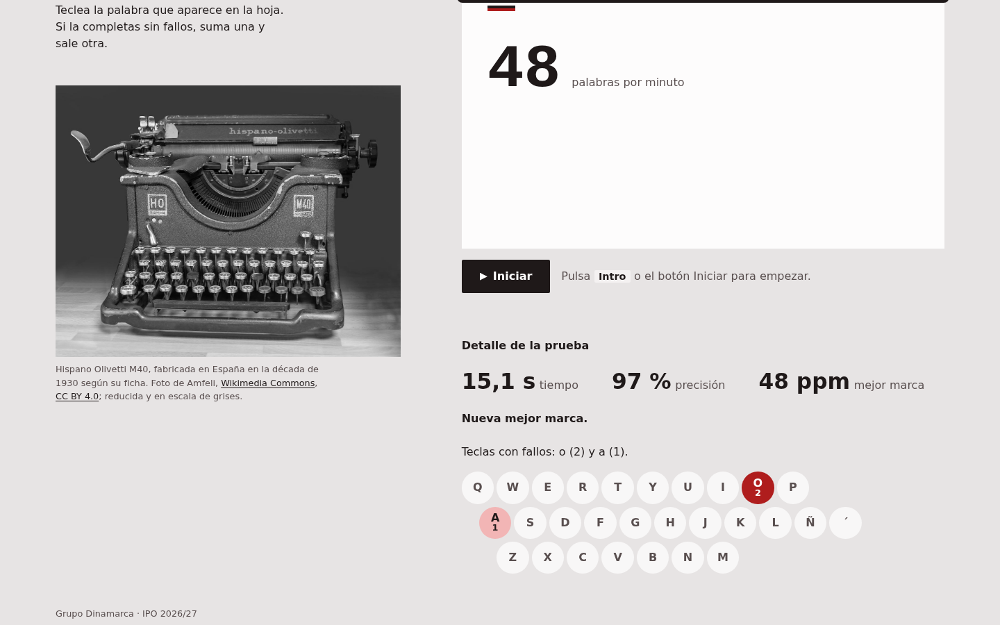

# Mecanografía · Test de velocidad

[Probar en línea](https://ipo-2627-dinamarca.github.io/ipo2627_dinamarca_mecanografia/)



Práctica de IPO 2026/27, grupo Dinamarca.

Aplicación web para medir la velocidad al teclado. Se pulsa Iniciar, aparece una palabra elegida al azar y hay que escribirla; en cuanto se completa sin errores sale otra y el contador sube. Un temporizador muestra los segundos desde el comienzo y, al detener, la hoja enseña las palabras por minuto y debajo aparece el detalle con un teclado que marca las teclas más falladas.

## Cómo ejecutarla

Las palabras se cargan con `fetch` y los scripts son módulos ES, así que la página tiene que servirse por HTTP:

```bash
python3 -m http.server 8080
# http://localhost:8080
```

Abierta con `file://`, el navegador bloquea el módulo y la página se queda en su estado inicial, que es un aviso explicando cómo servirla.

## Funcionamiento

- Iniciar y Detener: el mismo botón arranca y para la prueba. También se empieza con Intro desde cualquier parte de la página y se detiene con Esc.
- Palabra de muestra: se sortea entre las del almacén y nunca repite la anterior.
- Validación letra a letra: cada letra se colorea según vaya bien, mal o falte por escribir, y un subrayado marca la siguiente. La palabra se acepta sola al completarla. Espacio o Intro la comprueban antes de tiempo y, si está incompleta o tiene errores, lo indican; con el campo vacío no hacen nada. Comprobar una palabra correcta pero a medias cuenta como un fallo, apuntado a la letra que faltaba. Si ya tenía una letra mal, ese fallo se contó al teclearla y la comprobación no suma otro. El campo admite como mucho tres letras más que la palabra.
- Contador de correctas: sube con cada acierto y vuelve a cero en cada nuevo comienzo.
- Temporizador: arranca al pulsar Iniciar con `setInterval` y se para con `clearInterval`. Muestra los segundos transcurridos y, pasados cinco segundos, las palabras por minuto en vivo.
- Resultado: al detener, la cifra de palabras por minuto ocupa en la hoja el sitio de la palabra. Los marcadores se quedan con las correctas y los segundos finales, y debajo del botón aparece el detalle: el tiempo con una décima, la precisión, la mejor marca y el teclado de fallos. La marca se guarda en `localStorage` y solo cuentan las pruebas de cinco segundos o más; si se supera, se avisa.
- Teclado de fallos: un teclado español (QWERTY con Ñ) tiñe de rojo las teclas falladas en esa prueba, más intenso cuanto más se han fallado, y una frase debajo las enumera. Cada fallo se apunta a la tecla de la letra que se pedía. Si solo faltó la tilde o la diéresis (`a` por `á`), se apunta a la tecla `´`, que en el teclado español está a la derecha de la Ñ y sirve para las dos. Lo que se teclea de más no corresponde a ninguna tecla y no se apunta. Por eso la suma del teclado nunca supera los fallos que cuenta la precisión, aunque puede quedarse por debajo.

Se exigen las tildes, pero no las mayúsculas: las palabras del almacén están en minúscula y un bloqueo de mayúsculas olvidado no debería contar como fallo. El campo no admite pegar ni arrastrar texto.

## Estructura

```
ipo2627_dinamarca_mecanografia/
├── index.html
├── favicon.svg           una tecla redonda de la M40 con la ñ
├── DESIGN.md             dirección de arte y especificación del diseño
├── img/
│   └── hispano-olivetti-m40.jpg
├── css/
│   ├── tokens.css        orden de capas y variables (color, tipografía, espacio)
│   ├── base.css          reinicio, elementos sueltos y utilidades
│   ├── layout.css        disposición de las cajas y consulta de contenedor
│   └── componentes.css   aspecto de marcadores, hoja, campo, botón, detalle y teclado de fallos
├── js/
│   ├── main.js           punto de entrada
│   ├── model/
│   │   ├── almacen.js    carga de palabras y mejor marca
│   │   └── modelo.js     estado y reglas de la prueba
│   ├── view/
│   │   └── vista.js      lectura y escritura del DOM
│   └── controller/
│       └── controlador.js
└── data/
    └── palabras.json
```

El HTML enlaza las cuatro hojas con `<link>` y un único `<script type="module">` hacia `main.js`; el resto de ficheros se importan entre sí con `import`. Las hojas usan `@layer`. El orden (`tokens, base, layout, componentes, utilidades`) se declara una vez en `tokens.css` y cada fichero rellena su capa: `layout` decide cómo se colocan las cajas (`display`, rejillas, `gap`) y `componentes` cómo se ven. Así la cascada depende de las capas y no hace falta subir la especificidad ni usar `!important`: hasta la regla de `[hidden]` está en `utilidades`, la última capa.

## Arquitectura

Sigue el patrón MVC.

- `model/almacen.js` descarga `palabras.json`, descarta entradas repetidas o con espacios y normaliza a NFC. Sus errores llevan un mensaje pensado para el usuario según la causa: fallo de red, respuesta HTTP o JSON mal formado. También lee y guarda la mejor marca dentro de `try/catch`, porque `localStorage` puede no estar disponible, y descarta valores fuera de rango.
- `model/modelo.js` guarda el estado en campos privados: palabra actual, texto escrito, correctas, pulsaciones, fallos, fallos por tecla, instante de inicio y de fin. Expone getters de solo lectura (`hayError`, `precision`, `palabrasPorMinuto`, `fallosPorTecla`…), el método `progreso()` y las operaciones `comenzar`, `escribir`, `confirmar` y `detener`. A qué tecla se apunta un fallo es una regla del dominio y vive aquí. No toca el DOM.
- `view/vista.js` localiza los nodos por atributos `data-vista`, escribe en ellos los valores que recibe (también reparte los fallos en cuatro niveles de color y redacta el resumen) y avisa al controlador de lo que hace el usuario mediante `alPulsarBoton`, `alEscribir` y `alPulsarAtajo`. No conoce el modelo.
- `controller/controlador.js` es el único que habla con los dos y el dueño del intervalo.
- `main.js` crea las piezas tras cargar las palabras con `await` en el nivel superior del módulo; si algo falla, la vista muestra el mensaje.

### El temporizador

El enunciado pide `setInterval`, pero contar ticks acumula deriva y en una pestaña en segundo plano el navegador los espacia. Por eso el modelo guarda `performance.now()` al comenzar y al detener y calcula el tiempo como diferencia. El intervalo, cada 200 ms, solo repinta los marcadores, y la vista únicamente toca el DOM si la cifra ha cambiado. El resultado final usa el tiempo real, con décimas, y las palabras por minuto salen exactas. Al detener, el controlador repinta los marcadores una última vez para que muestren el valor final y no el del último tic.

### Coordinación con el DOM y el CSSOM

El estado se comunica sobre todo con atributos, y el CSS decide cómo se ve:

- `data-estado` en `.app` vale `error` en el HTML de partida y después `cargando`, `parado` o `activo`. De él dependen la ayuda visible, el aspecto del botón, el campo deshabilitado y el modo compacto.
- `aria-invalid` en el campo sirve a la vez a las tecnologías de apoyo y como gancho del estilo de error. El mensaje de error aparece con el combinador de hermano (`.campo[aria-invalid="true"] + .controles__error`). Con `:has()`, mientras el resultado está abierto, se esconden las PPM del marcador, porque la cifra ya está en la hoja, y también la etiqueta y el renglón vacío, sin que cambie su alto.
- Cada letra de la muestra es un `<span>` con clase `letra--ok`, `letra--error`, `letra--pendiente` o `letra--sobrante`, más `letra--cursor` en la siguiente. Los spans se crean una vez por palabra y en cada pulsación solo cambian sus clases.
- Las 28 teclas del teclado de fallos se crean una sola vez. Al detener, la vista solo cambia su atributo `data-nivel` (de 0 a 4) y la cuenta que llevan dentro; el color sale del CSS.

El único estilo que escribe el JavaScript es la propiedad personalizada `--letras`, con `style.setProperty`, y la escribe en `.hoja`, no en la muestra. Así la heredan la muestra y el campo, que calculan el mismo cuerpo con `clamp(2rem, calc(150cqi / var(--letras)), var(--cuerpo-max))`. La hoja es contenedor de consulta, de modo que `cqi` se mide contra su ancho y una palabra larga en una pantalla estrecha baja de tamaño y cabe en una línea.

El teclado usa *subgrid*: la rejilla tiene 23 columnas de media tecla, cada fila hereda esas columnas y cada tecla ocupa dos, así que basta con empezar la segunda fila en la columna 2 y la tercera en la 3 para escalonarlas como en la máquina. La palabra y la cifra del resultado se apoyan al fondo de su celda con `align-content: end`, que ya funciona en bloques normales sin convertirlos en rejilla.

Las clases siguen BEM y se usan para el estilo; los `data-vista` los usa el JavaScript para encontrar nodos.

## Diseño

La idea de partida es la hoja de papel metida en una Hispano Olivetti M40, de la filial española de Olivetti, con la ñ en el teclado. La hoja sale de un rodillo, una barra de tinta redondeada algo más ancha que ella, y lleva en el punto de impresión un trozo de cinta de dos bandas, negra y roja, el único detalle de color fuera del error. La palabra de muestra aparece en la hoja en gris, como el modelo impreso de un cuaderno de academia, y lo que se teclea va cayendo encima en tinta negra; los errores, en tinta roja, como con la cinta bicolor. El detalle completo, con medidas y contrastes, está en `DESIGN.md`.

### Cromático: monocromática sobre el rojo de la cinta

Hay un solo tono, `--tono: 0` (el rojo del círculo cromático), y todo lo demás sale de mover la saturación y la luminosidad en HSL. Con una saturación de entre el 5 y el 14 % salen los neutros, grises con una temperatura muy leve y todos de la misma familia. Con el 70-75 % sale el rojo, que se reserva para el error. El acierto no tiene color propio: es la tinta normal, igual que en la máquina.

| Variable | Papel | Claro | Oscuro |
|---|---|---|---|
| `--mesa` | fondo de la página | `#e7e4e4` | `#191515` |
| `--papel` | la hoja | `#fdfcfc` | `#262121` |
| `--renglon` | fondo del campo | `#f4f1f1` | `#312b2b` |
| `--tinta` | texto, letras acertadas, botón, rodillo | `#1f1919` | `#ede8e8` |
| `--tinta-intensa` | botón al pasar el puntero | `#433737` | `#d1c7c7` |
| `--tinta-suave` | etiquetas y notas | `#594f4f` | `#bcb3b3` |
| `--guia` | letras pendientes | `#736868` | `#a39999` |
| `--borde` | renglón del campo, controles deshabilitados | `#7c6e6e` | `#8c7d7d` |
| `--cinta` | error, banda roja de la cinta | `#af1d1d` | `#eb7070` |
| `--tinte-cinta` | fondo del campo con error | `#fbe9e9` | `#3d1a1a` |
| `--calor-0` a `--calor-4` | teclas del teclado de fallos | del gris al rojo | del gris al rojo |

Los dos modos se resuelven con `light-dark()` en la misma declaración. El oscuro funciona como papel carbón: la mesa casi negra, la hoja un escalón más clara y la tinta clara, de modo que la hoja sigue siendo la figura. Los contrastes cumplen WCAG AA en los dos: la tinta sobre el papel da 16,96 en claro y 13,08 en oscuro, las letras pendientes 5,24 y 5,73, y el rojo sobre el papel 6,79 y 5,34. El rojo y el gris de las letras pendientes tienen casi la misma luminosidad, y por eso el error nunca se marca solo con color.

### Tipográfico: dos familias contrastadas, cada una con su papel

- Monoespaciada de máquina (`Courier New` y sus equivalentes de Linux) para lo que escribe la máquina: la palabra, el texto del campo y la cifra de PPM del resultado. La razón es funcional. Con paso fijo, y con la misma pila, el mismo peso, el mismo cuerpo y la misma sangría en la muestra y en el campo, cada letra tecleada queda justo debajo de la letra que la pide. Va en negrita porque la Courier New normal es demasiado fina en pantalla, y en Courier la negrita no cambia el ancho. Muchas distribuciones de Linux no traen Courier New; en ese caso la pila pasa a Courier 10 Pitch, Nimbus Mono PS o Liberation Mono, y en último término a la monoespaciada del sistema. La alineación no se pierde, porque depende de que la muestra y el campo usen la misma pila y no de una fuente concreta.
- Sans de sistema para todo lo que dice la aplicación: título, etiquetas, marcadores, ayuda, botón, detalle y teclado de fallos. `system-ui` es la familia genérica que apunta a la fuente de la interfaz de cada sistema (Segoe UI, San Francisco, Cantarell o Roboto), así que se cumple lo de usar fuentes estándar.

No se descarga ninguna fuente. Los tamaños de texto salen de una escala modular de razón 1,25 en `rem`; solo la palabra de la hoja tiene un cuerpo fluido aparte. Las cifras usan `tabular-nums` y las mayúsculas se dejan para las teclas, como en un teclado real.

### Espacial

En escritorio, a partir de 60 rem, la página es una rejilla de dos columnas desiguales (`5fr` y `7fr`): a la izquierda la cabecera y la foto de la máquina y a la derecha la prueba. Por debajo queda una sola columna de 44 rem como máximo, y la foto pasa después de la prueba, que es su sitio en el DOM, así que el orden de lectura coincide con el visual sin usar `order`. Todo va alineado a la izquierda y la página está anclada arriba. Las medidas usan `rem`, `ch` para los textos, `cqi` para el cuerpo de la hoja, `dvh` para el alto mínimo y `fr` para las columnas, siempre con propiedades lógicas.

Nada se mueve al empezar ni al terminar. La palabra y la cifra del resultado comparten una celda de alto fijo, el campo tiene también un alto fijo aunque su letra cambie con cada palabra y el detalle aparece debajo del botón. La palabra nunca se parte: va en una sola línea, su cuerpo se calcula para que la más larga del almacén quepa a 320 px y lo que sobra al final se recorta en lugar de bajar a otra línea. La línea del mensaje de error queda reservada y las dos ayudas comparten celda y se alternan con `visibility`. Así, al pulsar Iniciar, ya sea desde el estado inicial o desde un resultado, ni el campo ni el botón cambian de sitio.

Principios de la Gestalt aplicados:

- Figura y fondo: la hoja es más clara que la mesa y se separa de ella solo por el tono, sin bordes ni sombras. El rodillo oscuro de su borde superior refuerza la lectura del papel saliendo de la máquina.
- Proximidad: muestra, etiqueta, campo y mensaje de error van juntos dentro de la hoja; el botón y la ayuda forman otro grupo debajo, y el detalle queda más apartado.
- Semejanza: todas las medidas, las de los marcadores y las del detalle, tienen la misma forma, una cifra grande en negrita con el nombre detrás. La tinta roja significa error en la letra, en el campo, en el mensaje y en el teclado.
- Continuidad: muestra y campo comparten borde izquierdo y paso de letra, y el ojo baja en vertical de la letra pedida a la tecleada.
- Cierre: el teclado de fallos se lee como un teclado completo aunque solo son círculos sueltos en tres filas escalonadas.

`.principal` y `.hoja` son contenedores de consulta. Si la columna mide menos de 30 rem, el botón ocupa todo el ancho con la ayuda debajo, el cuerpo máximo de la palabra baja de 5,5 a 4,5 rem, las correctas ocupan su propia línea con los segundos y las PPM debajo, y las teclas del teclado de fallos se juntan para ganar tamaño. En el móvil, `interactive-widget=resizes-content` hace que el teclado virtual encoja la ventana; si queda por debajo de 34 rem de alto durante la prueba, se ocultan la cabecera, la foto, el pie y la ayuda y la palabra baja a 3,25 rem, para que la palabra, el campo y el tiempo sigan a la vista.

## Interacción y accesibilidad

- Atajos: Intro empieza, Esc detiene y cualquier letra pulsada fuera del campo durante la prueba devuelve allí el foco. Se indican con `<kbd>` en una ayuda que cambia según el estado y en `aria-keyshortcuts`.
- Foco: al empezar va al campo y al detener al botón, así que Intro o Espacio relanzan la prueba sin ratón.
- El segundo clic de un doble clic en el botón se ignora (`event.detail`), y Esc con la prueba parada no hace nada.
- Teclados: con teclas muertas se espera a `compositionend` para que la tilde suelta no cuente como fallo. Los teclados de móvil que componen la palabra entera ven el progreso mientras escriben, y el Espacio, que en ellos no informa de la tecla, se detecta en el texto.
- El error se señala con algo más que el color: subrayado ondulado en la letra, tachado en lo que sobra, fondo y renglón del campo y un mensaje escrito.
- El teclado de fallos está oculto para las tecnologías de apoyo (`aria-hidden`) y no tiene nada enfocable. Toda su información está en el `figcaption`, que es texto visible y da nombre a la figura, y el anuncio final la repite. Así un lector de pantalla oye "Teclas con fallos: ñ (3), r (2) y tilde (1)" en lugar de recorrer 28 teclas. El nivel tampoco depende solo del color: en pantallas anchas cada tecla lleva su cuenta.
- Una sola región viva, fuera de los spans, anuncia el comienzo, cada palabra nueva, el primer error y el resumen final con las teclas falladas. Los marcadores son un `<dl>` sin `aria-live`, para que el lector de pantalla no lea el reloj cada segundo.
- Movimiento: las letras no se mueven nunca. Al acertar, la cifra de correctas da un golpe corto, como el tipo que sube, marca y vuelve (140 ms, solo `transform`). Al detener, la cifra del resultado y las piezas del detalle entran con un fundido escalonado desde `@starting-style`, porque pasan de `display: none` a visibles. El golpe, los fundidos, las transiciones de color del campo y del botón y el cambio de su icono solo se aplican con `prefers-reduced-motion: no-preference`. Al pulsarlo, el botón baja 1 px, y su *hover* solo existe con `(hover: hover)`, para que en una pantalla táctil no se quede marcado tras tocarlo.
- `forced-colors`: la hoja recupera un borde, el campo pasa a borde completo (doble si hay error) sin perder la alineación con la muestra, las letras erróneas y las teclas falladas usan los colores de resaltado del sistema (`Mark`), el foco del campo usa `Highlight` y el icono del botón toma `ButtonText`.
- `prefers-contrast: more`: las letras pendientes y el renglón pasan a la tinta suave, la mesa se oscurece un escalón para que la hoja destaque más, el renglón y el subrayado del error engordan y en el teclado de fallos las letras de las teclas sin fallos pasan a la tinta y el tercer nivel de rojo se separa más de su letra (de 5,5 a más de 6,8 de contraste).
- El botón mide al menos 48 px de alto y el campo bastante más. El foco es un anillo de 3 px en tinta; con error pasa a rojo, y se ve un solo anillo.

## Créditos

La foto de la máquina es "Máquina de escribir Hispano Olivetti M40", de Amfeli, publicada en [Wikimedia Commons](https://commons.wikimedia.org/wiki/File:M%C3%A1quina_de_escribir_Hispano_Olivetti_M40.jpg) con licencia [CC BY 4.0](https://creativecommons.org/licenses/by/4.0/deed.es). Para la práctica se ha reducido a 1280 × 1009 px y se muestra en escala de grises con un filtro CSS. El crédito aparece también en la página, junto a la foto.
